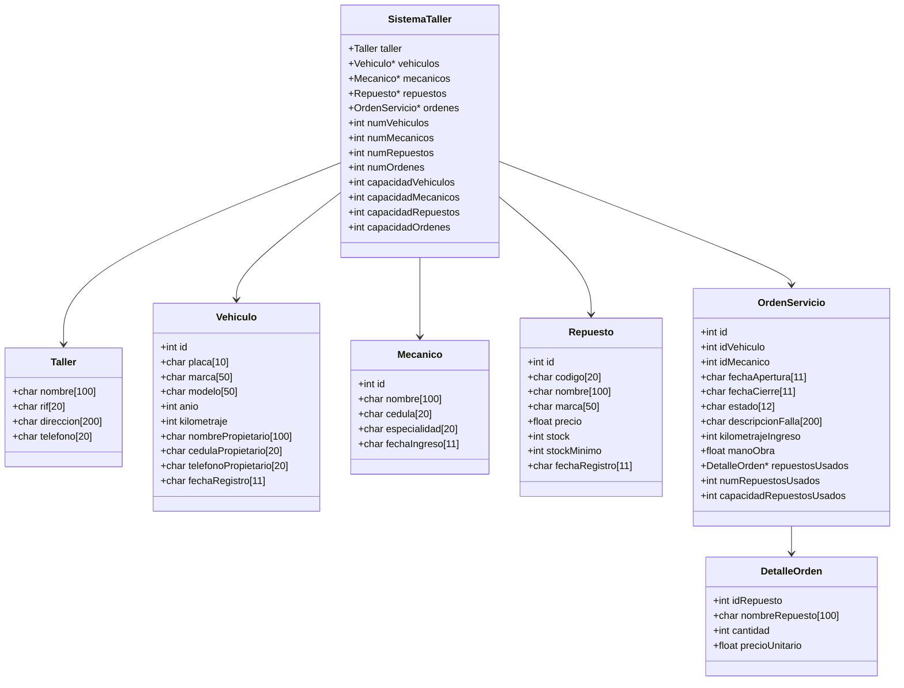

# Proyecto 1: Sistema general de taller mecanico

## Integrantes y desarrolladores:

- Lucas Rodriguez
- Isidro Marmol

## Descripcion general del programa: 
"El programa en cuestion tiene el objetivo de servir como administrador de un taller mecanico, con el objetivo de gestionar y administrar la informacion relacionada a varios tipos de vehiculos, repuestos, ordenes de servicio y mecanicos en cuestion, presentando una manera centralizada y amigable de supervisar dichos apartados a traves de un menu por consola".

Cada apartado se concentra de la siguiqnte manera:
- Vehiculos: Registro, consulta por ID, busqueda por placa o propietario, eliminacion logica/fisica, actualizacion.
- Mecanicos: Registro, busqueda por ID y cedula y listado de cada uno de los ya registrados.
- Repuestos: Registro, busqueda por ID, codigo y nombre, entrada de mercancia, cambio de precio de los repuestos ya regitrados, eliminacion logica y listado.
- Ordenes de servicio: Inicio para abrir la orden, agregacion o eliminacion de algun repuesto para el mismo, cierre o anulacion de la orden, detalles y listado de cada orden.
- Listado general de registros: Creado para el control y recuento de todos los elementos registrados con anterioridad.

## Instrucciones de compilacion:

Requisitos:
- Compilador de C++ (g++, MinGW o MSVC)
- Consola o terminal
- Sistema operativo Windows, Linux o macOS

Pasos para la ejecutacion:
- Descarga de los archivos y carpetas por medio del ZIP en repositorio de github (usando el boton <>Code).
- Ingreso al archivo y codigo "main.cpp" en Visual Studio Code con lenguaje C++.
- Abrir terminal por medio de "GitBash" ingresando el comando "git add ." en la carpeta de Fase 1.
- Posteriormente ingresar el comando: g++ "main.cpp" -o taller.
- Se crear un archivo .exe llamado "taller" y por ultimo ingresar el comando especificio y ya estara dentro del programa:

Windows:
./taller.exe

Linux/macOS:
./taller

### Diagrama de estructuras y relaciones

### Estructuras principales



### Relación orden → detalles

La relación entre `OrdenServicio` y `DetalleOrden` es de composición dinámica. Cada orden tiene un arreglo de detalles (`repuestosUsados`), y cada detalle representa un repuesto consumido en esa orden. Por eso se usa un puntero a `DetalleOrden` en lugar de un arreglo fijo dentro de la estructura.

```text
OrdenServicio
    |
    +--> repuestosUsados: DetalleOrden*
             |
             +--> DetalleOrden[0]
             +--> DetalleOrden[1]
             +--> DetalleOrden[n]
```

En otras palabras, una orden puede incluir varios repuestos, y cada uno guarda:
- id del repuesto
- nombre del repuesto
- cantidad solicitada
- precio unitario al momento de agregarse

## Explicación de la separación de capas

El proyecto se organiza de manera lógica en tres niveles principales:

### 1. Capa de datos / estructura del sistema
Esta parte define los registros principales (`Vehiculo`, `Mecanico`, `Repuesto`, `OrdenServicio`, `DetalleOrden`, `Taller` y `SistemaTaller`). Aquí se guardan los arreglos dinámicos, las capacidades, los contadores y los identificadores.

### 2. Capa de lógica de negocio
Aquí se implementan las funciones que realizan las operaciones del sistema:
- validaciones
- búsquedas
- agregados
- actualización
- eliminación
- cálculos de totales
- redimensionamiento de arreglos dinámicos

Ejemplos:
- `agregarVehiculo(...)`
- `buscarVehiculoPorID(...)`
- `agregarRepuestoAOrden(...)`
- `cerrarOrden(...)`
- `calcularTotalOrden(...)`

### 3. Capa de interfaz / menú
Es la capa que interactúa con el usuario y presenta los datos en consola. Aquí se leen entradas, se muestran mensajes, se validan opciones del menú y se llaman a la lógica del sistema.

Ejemplos:
- `menuRegistrarVehiculo(...)`
- `menuBuscarMecanico(...)`
- `menuRegistrarRepuesto(...)`
- `menuAbrirOrden(...)`
- `menuListarOrdenes(...)`

La separación se hace para que la lógica del negocio no dependa directamente de la entrada/salida del usuario, y así el código sea más ordenado, mantenible y reutilizable.

## Firmas diseñadas y justificación del tipo de retorno

A continuación se presentan algunas de las firmas más relevantes del sistema y la razón de su tipo de retorno.

### Módulo de mecánicos

```cpp
Mecanico* agregarMecanico(SistemaTaller* s, Mecanico datos);
Mecanico* buscarMecanicoporID(SistemaTaller* s, int id);
Mecanico* buscarMecanicoporCedula(SistemaTaller* s, const char* cedula);
Mecanico* listarMecanico(SistemaTaller* s, int* cantidad);
```

Justificación:
- Se retorna `Mecanico*` porque es conveniente apuntar directamente a la posición del arreglo dentro del sistema. Esto evita copiar estructuras grandes y permite modificar o consultar al mecánico real en memoria.
- En validaciones o búsquedas fallidas, el valor devuelto es `nullptr`, lo que hace fácil controlar errores.

### Módulo de repuestos

```cpp
Repuesto* agregarRepuesto(SistemaTaller* s, Repuesto datos);
Repuesto* buscarRepuestoPorID(SistemaTaller* s, int id);
Repuesto* buscarRepuestoPorCodigo(SistemaTaller* s, const char* codigo);
Repuesto* buscarRepuestoPorNombreParcial(SistemaTaller* s, const char* subcadena);
bool cambiarPrecioRepuesto(SistemaTaller* s, int idRepuesto, float nuevoPrecio);
bool menuRegistrarEntradaMercancia(SistemaTaller* s, int idRepuesto, int CantidadAdicional);
```

Justificación:
- `Repuesto*` se utiliza en búsquedas para devolver la referencia exacta del repuesto dentro del arreglo, lo que facilita consultar o modificar stock, precio y nombre.
- `bool` se usa cuando la operación solo necesita responder si tuvo éxito o no, por ejemplo al cambiar el precio o registrar una compra adicional de mercancía.

### Módulo de órdenes

```cpp
OrdenServicio* abrirOrden(SistemaTaller* s, int idVehiculo, int idMecanico, const char* descripcionFalla, int KilometrajeIngreso, const char* fechaActual);
bool agregarRepuestoAOrden(SistemaTaller* s, int idOrden, int idRepuesto, int cantidad);
bool quitarRepuestoDeOrden(SistemaTaller* s, int idOrden, int idRepuesto);
bool cerrarOrden(SistemaTaller* s, int idOrden, float manoObra, const char* fechaActual);
bool anularOrden(SistemaTaller* s, int idOrden);
float calcularTotalOrden(const OrdenServicio* orden);
```

Justificación:
- `OrdenServicio*` se devuelve en `abrirOrden` porque una vez creada la orden, puede necesitarse acceder de inmediato a la instancia recién creada para actualizarla o mostrarla.
- `bool` es apropiado en operaciones de alta, baja o modificación de estado: agregar repuesto, quitar repuesto, cerrar o anular orden.
- `float` se usa en `calcularTotalOrden` porque el total incluye valores monetarios con decimales, como el costo de repuestos y la mano de obra.

## Preguntas de analisis: 

### 1) ¿Qué ocurre si `agregarVehiculo` retorna un puntero a `s->vehiculos` y luego se guardan varios vehículos más y se usa ese puntero?

Si se guarda el puntero devuelto por `agregarVehiculo`, y luego el arreglo de vehículos se redimensiona (`redimensionarVehiculos`), el contenido del arreglo se copia a un bloque nuevo de memoria y el puntero viejo queda apuntando a la zona antigua.

Esto ocurre porque la función `redimensionarVehiculos` hace esto:

```cpp
Vehiculo* nuevosVehiculos = new Vehiculo[s->capacidadVehiculos];
for (int i = 0; i < s->numVehiculos; i++) {
    nuevosVehiculos[i] = s->vehiculos[i];
}
delete[] s->vehiculos;
s->vehiculos = nuevosVehiculos;
```

Entonces, si se conserva un puntero viejo, se vuelve inválido tras la reasignación, porque la memoria original fue liberada con `delete[]`. El resultado es que el puntero puede apuntar a memoria liberada o a datos que ya no corresponden al arreglo actual, provocando comportamiento indefinido.

### 2) ¿Por qué `DetalleOrden` guarda `precioUnitario` en lugar de consultar el precio del repuesto cada vez que se calcula el total?

Porque `precioUnitario` representa el precio vigente en el momento en que se registró el repuesto dentro de la orden. Esto es importante porque si luego el precio del repuesto cambia en el inventario, la orden ya emitida no debería modificar su costo original.

Además, esto garantiza:
- consistencia histórica del costo
- cálculo estable del total
- independencia entre el inventario actual y la factura/orden registrada

Si se consultara siempre el precio actual del repuesto, el total de la orden podría cambiar sin que la operación original se hubiese modificado, lo cual no es correcto.

### 3) Cuando se redimensiona el arreglo de órdenes, ¿qué ocurre con el arreglo de detalles de cada orden?

En la implementación, la redimensión del arreglo principal de órdenes hace una copia por valor de cada `OrdenServicio`:

```cpp
for (int i = 0; i < s->numOrdenes; i++) {
    nuevasOrdenes[i] = s->ordenes[i];
}
```

Esto copia el contenido completo del objeto `OrdenServicio`, y entre sus campos se encuentra el puntero `repuestosUsados`.

Por esta razón:
- no se hace una copia profunda del arreglo de detalles
- se copia únicamente la dirección de memoria apuntada por `repuestosUsados`
- el arreglo de `DetalleOrden` original no se duplica, sino que el nuevo `OrdenServicio` apunta al mismo bloque de memoria

Luego se hace:

```cpp
delete[] s->ordenes;
s->ordenes = nuevasOrdenes;
```

Eso libera solo el arreglo de objetos `OrdenServicio`, pero no elimina cada arreglo de detalles individual. Es decir, los detalles quedan vivos y son reutilizados por la nueva estructura. En la práctica, el puntero se comparte por copia, no se pierde, siempre que se gestione correctamente el ciclo de liberación final del sistema.

## Observaciones finales

Este proyecto demuestra la aplicación de:
- Arreglos dinámicos
- Punteros
- estructuras
- validaciones
- búsquedas
- redimensionamiento de memoria
- gestión de relaciones entre entidades del dominio del problema

Es una solución adecuada para entender el manejo de memoria en C++ y la relación entre estructuras que representan un sistema real de gestión empresarial.

## Observaciones finales

Este proyecto demuestra la aplicación de:
- Arreglos dinámicos
- Punteros
- Estructuras generales de C++
- Validaciones
- Busquedas de informacion
- Redimensionamiento de memoria
- Gestión de relaciones entre entidades del dominio del problema
- Separacion de capa logica y de presentacion

## Licencia

Este proyecto fue desarrollado con fines académicos.

UNIVERSIDAD RAFAEL URDANETA

LABORATORIO DE PROGAMACION II 

SECCION H

PROFESOR: VICTOR KNEIDER

FECHA DE ENTREGA:
22-10-2026

